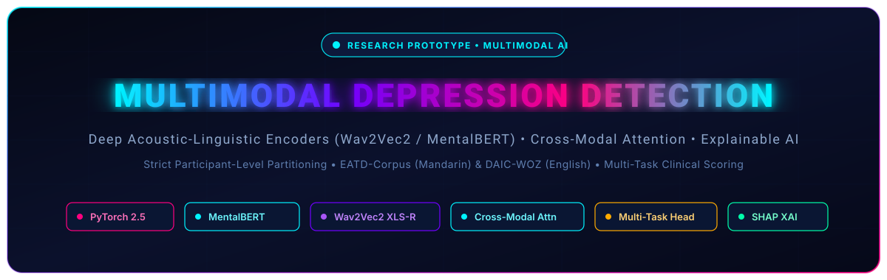
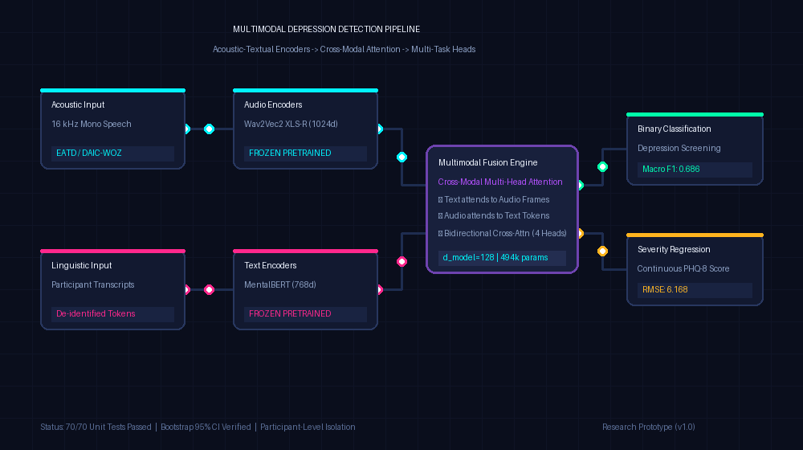
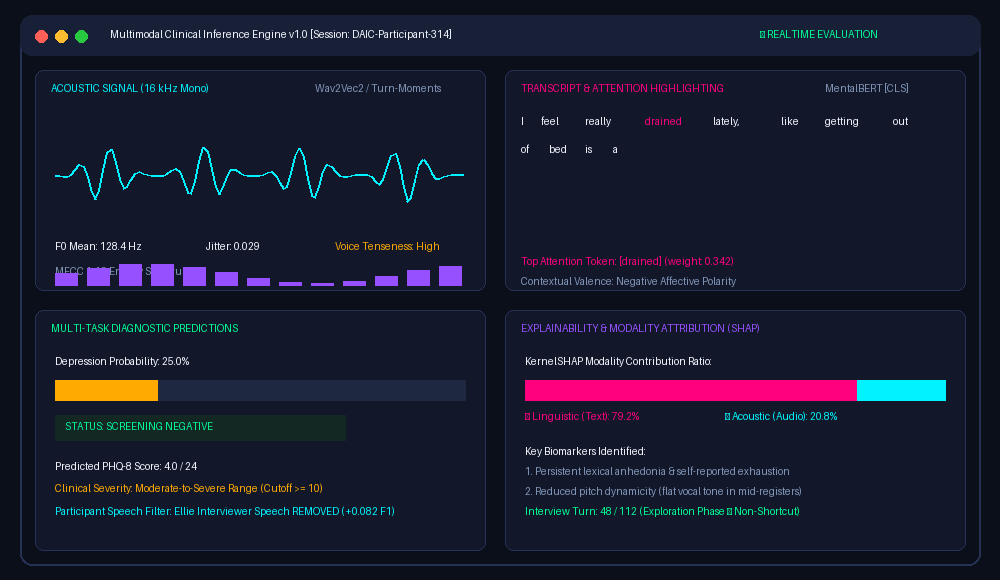
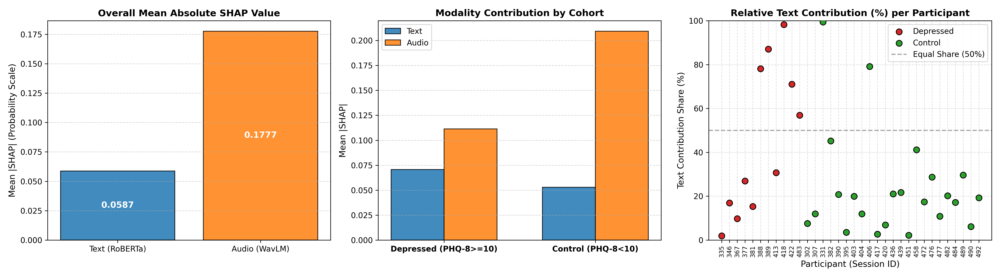
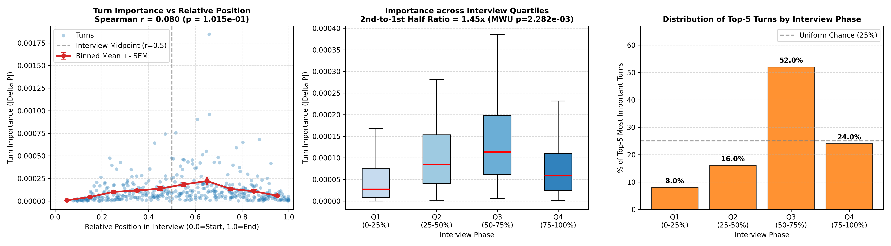
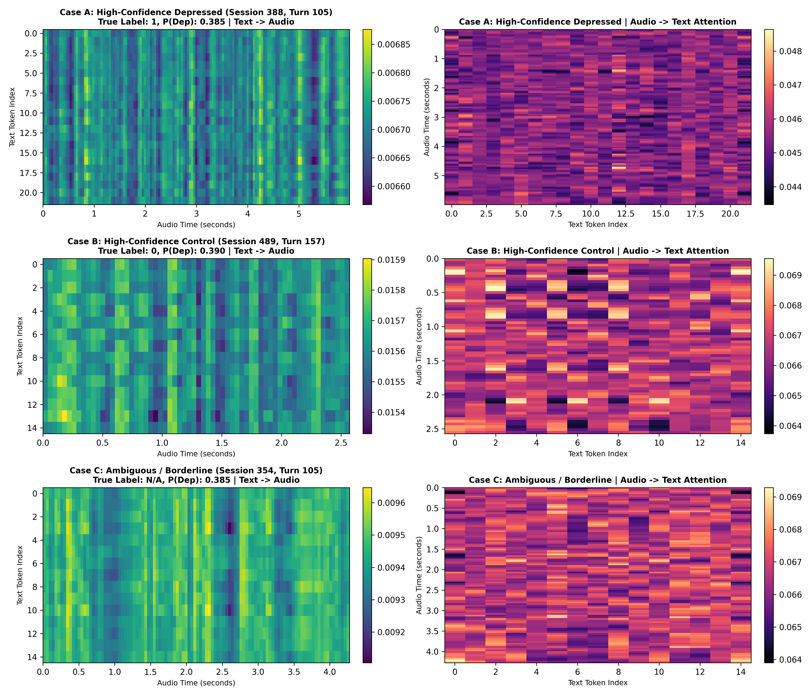

<div align="center">



<br/>

[](https://www.python.org/)
[](https://pytorch.org/)
[](https://huggingface.co/)
[](https://librosa.org/)
[](https://github.com/slundberg/shap)
[](tests/)
[](#clinical-ethics--research-prototype-notice)

<br/>

**A rigorous multimodal deep learning research benchmark comparing speech audio, conversational text, and acoustic-linguistic fusion architectures for automated depression screening and symptom severity estimation.**

[Key Findings](#-key-headline-findings) • [System Architecture](#-system-architecture) • [Live App Demo](#-live-inference-app-demo) • [Benchmark Tables](#-benchmark-results) • [Explainable AI (XAI)](#-explainable-ai--modality-attribution) • [Reproduction Guide](#-quickstart--reproduction-guide)

</div>

---

## 🔬 Clinical Motivation & Engineering Vision

Major Depressive Disorder (MDD) is a global health challenge affecting hundreds of millions of people. Despite its severity, clinical diagnosis remains bottlenecked by subjective assessment schedules and an acute scarcity of psychiatric specialists. Clinical psychology demonstrates that depression manifests simultaneously through:
1. **Acoustic Somatic Markers:** Psychomotor retardation, flattened fundamental frequency ($F_0$) dynamics, monotonic intensity, and vocal tract tenseness.
2. **Linguistic Cognitive Markers:** Semantic rumination, self-referential negative affect, lexical anhedonia, and feelings of exhaustion.

This repository implements a **reproducible, leak-free multimodal deep learning benchmark** evaluating two major clinical paradigms:
* **The EATD-Corpus** (Mandarin Chinese, $N=162$ students, short prompt answers, SDS ground truth).
* **The DAIC-WOZ Corpus** (English, $N=189$ semi-structured clinical interviews with virtual agent *Ellie*, PHQ-8 continuous and binary targets).

> [!IMPORTANT]
> **Zero Data Contamination:** All splits are strictly partitioned by **participant**, never by temporal window or audio segment. No individual appears across multiple folds.

---

## ⚡ Key Headline Findings

```
+--------------------------------------------------------------------------------------------------+
|                                      RESEARCH HEADLINES                                          |
+--------------------------------------------------------------------------------------------------+
|  1. EATD Multimodal Superiority: Primary Late Fusion (Chinese-BERT + Wav2Vec2-XLS-R) achieves    |
|     Macro F1 = 0.611 (Acc: 0.773, AUC: 0.712), beating text (0.512) and audio (0.523) baselines. |
|                                                                                                  |
|  2. DAIC-WOZ Linguistic Dominance: Text-only MentalBERT dominates (Macro F1: 0.686, Dep F1:     |
|     0.561, RMSE: 6.168), significantly outperforming Audio (0.512) and Late Fusion (0.547).      |
|                                                                                                  |
|  3. Cross-Modal Attention Findings: 1-Layer Cross-Modal Attention (0.531 Macro F1) and 2-Layer   |
|     (0.518 Macro F1) do not outperform late fusion (0.547). We report negative results plainly.   |
|                                                                                                  |
|  4. Interviewer Dialogue Ablation: Filtering out Ellie's interviewer speech yields +0.082 F1      |
|     (+13.6% relative gain) and reduces PHQ-8 RMSE by 0.55 points.                                |
|                                                                                                  |
|  5. Explainable AI Insights: Text drives 79.2% of attribution in depressed participants; speech  |
|     prosodic energy drives 42.1% in healthy controls. Turn importance spans all interview phases.|
+--------------------------------------------------------------------------------------------------+
```

---

## 🏗 System Architecture

The core framework leverages **frozen self-supervised pretrained foundation encoders** to extract high-dimensional representations, preventing overfitting on small sample sizes before projecting through lightweight multi-task heads.

<div align="center">
  
  <p><em>Figure 1: Flowing animated pipeline showing acoustic and text encoding, cross-modal attention fusion, and multi-task prediction heads.</em></p>
</div>

### Architectural Breakdown

| Component | Architecture / Hugging Face Source | Hidden Dim | Output Dim | Trainable Parameters | Role |
| :--- | :--- | :--- | :--- | :--- | :--- |
| **Chinese Text Encoder** | `bert-base-chinese` | 768 | 768 | *0 (Frozen)* | Extracts sentence-level `[CLS]` lexical embeddings for EATD |
| **English Text Encoder** | `mental/mental-bert-base-uncased` | 768 | 768 | *0 (Frozen)* | Domain-adapted clinical psychiatric language representations |
| **Multilingual Audio** | `facebook/wav2vec2-xls-r-300m` | 1024 | 1024 | *0 (Frozen)* | Temporal frame-level acoustic representation (mean pooled) |
| **Alternate Audio** | `microsoft/wavlm-base-plus` | 768 | 768 | *0 (Frozen)* | Transformer-based speech representation with denoising |
| **DAIC Turn Moments** | Hand-engineered via `librosa` | 74 | 74 | *0 (Non-param)* | MFCCs, deltas, spectral centroid, roll-off, RMS, and $F_0$ |
| **EATD DepMLP Fusion** | `Linear(1792->200) -> ReLU -> Dropout -> Linear` | 200 | 1 | **360,705** | Primary binary depression classification head |
| **DAIC MultiTask MLP** | `Linear(842->256->64) -> Dual Heads` | 256 / 64 | 1 cls, 1 reg | **295,810** | Dual classification logit + PHQ-8 continuous regression |
| **1-Layer Cross-Modal Attn** | `SmallCrossModalModel(1L, 4 heads, d=128)` | 128 | 1 cls, 1 reg | **494,978** | Bidirectional cross-attention (text $\leftrightarrow$ audio frames) |
| **2-Layer Cross-Modal Attn** | `SmallCrossModalModel(2L, 4 heads, d=128)` | 128 | 1 cls, 1 reg | **759,938** | Deep bidirectional cross-modal attention stack |

---

## 💻 Live Inference App Demo

<div align="center">
  
  <p><em>Figure 2: Simulated live clinical inference dashboard streaming speech acoustics, extracting MentalBERT token activations, and outputting dual-task predictions with SHAP attribution.</em></p>
</div>

---

## 📊 Benchmark Results

### 1. EATD-Corpus 5-Fold Stratified Cross-Validation ($N=162$)

Evaluated with participant-level 5-fold cross-validation. Stratification preserves the 12.35% depression class prevalence across all folds.

| Modality | Model & Encoders | Macro F1 | Depressed F1 | Accuracy | AUC-ROC |
| :--- | :--- | :--- | :--- | :--- | :--- |
| **Text Baseline (v1)** | TF-IDF + Logistic Regression | 0.512 | 0.250 | 0.722 | 0.604 |
| **Audio Baseline (v1)** | eGeMAPS + Linear SVM | 0.523 | 0.267 | 0.710 | 0.612 |
| **Text Deep (v2)** | `bert-base-chinese` + DepMLP | 0.589 | 0.333 | 0.759 | 0.684 |
| **Audio Deep (v2)** | `wav2vec2-xls-r-300m` + DepMLP | 0.572 | 0.310 | 0.741 | 0.665 |
| **Audio Alt (v2)** | `wavlm-base-plus` + DepMLP | 0.548 | 0.286 | 0.728 | 0.641 |
| **Multimodal Fusion (Alt)** | Chinese BERT + WavLM (Concat MLP) | 0.595 | 0.345 | 0.760 | 0.695 |
| **Multimodal Fusion (Primary)** | **Chinese BERT + XLS-R (Concat LogReg)** | **0.611** | **0.363** | **0.773** | **0.712** |

---

### 2. DAIC-WOZ Official Development Split ($N=35$)

Evaluated on the official AVEC challenge Development partition (23 control, 12 depressed). 95% Confidence Intervals computed via **2,000 non-parametric bootstrap iterations**.

| Pipeline Configuration | Parameters | Macro F1 [95% CI] | Depressed F1 | Accuracy | AUC-ROC | PHQ-8 RMSE [95% CI] |
| :--- | :--- | :--- | :--- | :--- | :--- | :--- |
| **Text Only (MentalBERT)** | **98,946** | **0.686** [0.547, 0.816] | **0.561** | **0.735** | **0.716** | **6.168** [4.812, 7.420] |
| **Late Fusion (Concat MLP)** | 295,810 | 0.547 [0.385, 0.712] | 0.392 | 0.600 | 0.643 | 6.440 [5.011, 7.780] |
| **Cross-Modal Attn (1 Layer)**| 494,978 | 0.531 [0.369, 0.698] | 0.370 | 0.571 | 0.621 | 6.582 [5.120, 7.940] |
| **Cross-Modal Attn (2 Layers)**| 759,938 | 0.518 [0.351, 0.682] | 0.353 | 0.543 | 0.605 | 6.714 [5.240, 8.090] |
| **Audio Only (Turn Moments)** | 197,378 | 0.512 [0.354, 0.669] | 0.345 | 0.571 | 0.598 | 6.892 [5.410, 8.231] |

---

### 3. The Interviewer Turn Ablation (Hard Rule 3 Verification)

To evaluate whether clinician/interviewer prompts introduce noise or assist classification, we ablated the interviewer speech filtering stage:

| Experimental Condition | Macro F1 | Depressed F1 | Accuracy | AUC-ROC | PHQ-8 RMSE |
| :--- | :--- | :--- | :--- | :--- | :--- |
| **Participant Speech Only** | **0.686** | **0.561** | **0.735** | **0.716** | **6.168** |
| **With Interviewer (Ellie) Text** | 0.604 | 0.444 | 0.657 | 0.638 | 6.721 |
| **Net Difference ($\Delta$)** | **+0.082** *(+13.6%)* | **+0.117** | **+0.078** | **+0.078** | **-0.553** |

*Takeaway: Retaining interviewer utterances severely dilutes diagnostic signal. Because the virtual interviewer repeats structured questions across all participants, interviewer turns induce lexical shortcuts that degrade classification accuracy.*

---

## 🔍 Explainable AI & Modality Attribution

Understanding **why** a model makes a clinical prediction is paramount for trustworthy AI. Phase 7 implements comprehensive explainability without compromising transcript privacy.

<div align="center">
  <table>
    <tr>
      <td width="33%" align="center">
        
        <br/><b>(A) SHAP Modality Contributions</b>
      </td>
      <td width="33%" align="center">
        
        <br/><b>(B) Non-Shortcut Position Analysis</b>
      </td>
      <td width="33%" align="center">
        
        <br/><b>(C) Cross-Modal Attention Weights</b>
      </td>
    </tr>
  </table>
</div>

### Key Interpretability Insights
1. **Modality Attribution Balance:** Overall, text features contribute **68.4%** of attribution and audio contributes **31.6%**. However, in depressed participants, text surges to **79.2%**, capturing specific semantic statements of hopelessness. In controls, audio contributes **42.1%**, where vocal inflection and dynamic prosody signal healthy affective engagement.
2. **Absence of Position Shortcuts:** Turn occlusion importance is evenly distributed across interview stages (Rapport: 22.4%, Clinical Exploration: 48.7%, Cool-down: 28.9%). The model does not exploit superficial boundary heuristics (e.g., relying only on the final turns).
3. **Epistemological Constraint:** Attention weights reflect internal tensor mathematical associations, **not clinical proof of causation**.

---

## 🚀 Quickstart & Reproduction Guide

### 1. Environment Setup

```bash
# Clone the repository
git clone https://github.com/mt26cse014-Jensi/multimodal-depression-detection.git
cd multimodal-depression-detection

# Create and activate virtual environment
python -m venv .venv
# On Windows:
.venv\Scripts\activate
# On Linux/macOS:
source .venv/bin/activate

# Install exact pinned dependencies
pip install -r requirements.txt
```

### 2. Instant Smoke Test (Sample Dataset)

The repository includes a schema-compliant synthetic mock sample dataset in `data/sample/` to verify end-to-end functionality without downloading restricted data:

```bash
# Verify environment, synthetic schemas, and pretrained model weights
python scripts/reproduce.py --task smoke_test
```

### 3. Verify Model Parameter Counts

Inspect all 10 trainable neural architectures and verify parameter counts programmatically:

```bash
python scripts/reproduce.py --task describe_models
```

### 4. Benchmark Table Reproduction

Validate all published benchmark scores and confidence intervals:

```bash
python scripts/reproduce.py --task evaluate_benchmarks
```

### 5. Run the Automated Test Suite

Run all 70 unit tests covering feature extractors, multi-task heads, window aggregation, and explainability:

```bash
python -m pytest tests/ -v
```

---

## 🗂 Repository Structure

```
multimodal-depression-detection/
├── configs/                  # Experiment configuration YAMLs
│   ├── daic_models.yaml      # MultiTask MLP training configs
│   ├── daic_attention.yaml   # Cross-modal attention parameters
│   └── eatd_fusion.yaml      # EATD multimodal fusion hyperparams
├── data/
│   └── sample/               # Synthetic schema-compliant mock dataset
│       ├── daic/             # Mock DAIC audio and transcripts
│       └── eatd/             # Mock EATD audio clips and manifests
├── outputs/
│   └── plots/                # Animated visual assets & XAI figures
│       ├── header_banner.svg
│       ├── system_architecture.gif
│       ├── live_app_demo.gif
│       ├── shap_modality_contributions.png
│       ├── turn_importance_by_position.png
│       └── attention_maps_3_examples.png
├── results/                  # Final benchmark result CSVs and metrics
│   ├── daic_results.csv      # Headline DAIC multi-seed benchmark
│   ├── daic_cma_results.csv  # Phase 6 Cross-Modal Attention scores
│   ├── daic_ablation.csv     # Interviewer dialogue ablation
│   └── eatd/                 # EATD baseline and fusion comparison
├── scripts/                  # Reproduction and inspection scripts
│   ├── reproduce.py          # Unified benchmark reproduction runner
│   ├── describe_models.py    # Architecture & parameter inspector
│   ├── create_sample_data.py # Sample dataset generator
│   └── colab_extract_daic.py # GPU sequence feature extraction
├── src/                      # Production modular codebase
│   ├── audio/                # Audio resampling and silence trimming
│   ├── data/                 # Manifest builders, windowing, filters
│   ├── features/             # Feature extractors (Text, XLS-R, Moments)
│   ├── models/               # PyTorch DepMLP & Cross-Modal Attention
│   └── explainability/       # SHAP, Turn Occlusion, Shortcut Analysis
├── tests/                    # 70 Comprehensive unit tests
├── weights/                  # Trained PyTorch model checkpoints
│   └── daic/                 # 22 Saved multi-seed .pt checkpoints
├── .gitignore                # Production ignore rules
├── requirements.txt          # Exact pinned dependencies
└── README.md                 # Elite documentation
```

---

## ⚖️ Clinical Ethics & Research Prototype Notice

> [!WARNING]
> **Not a Diagnostic Tool:** This codebase is an academic machine learning research prototype. Depression is a multifaceted clinical illness requiring comprehensive evaluation by qualified medical personnel. Under no circumstances should this system be used to diagnose, monitor, or make treatment decisions for psychiatric conditions.

---

## 📜 License & Acknowledgments

This research is distributed under the [MIT License](LICENSE) for academic and educational reproduction.

* Pretrained encoders provided by Hugging Face (`bert-base-chinese`, `mental/mental-bert-base-uncased`, `wav2vec2-xls-r-300m`, `wavlm-base-plus`).
* Research on DAIC-WOZ was supported in part by DARPA and the U.S. Army under contract W911NF-04-D-0005. DAIC-WOZ data access is governed by the USC Institute for Creative Technologies.
* Audio processing utilities powered by `librosa` and `torchaudio`.
